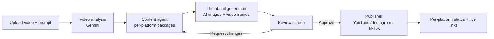

# pulseflow.ai

An AI agent that turns one video into ready-to-post content and publishes it for you.

Upload a video, describe the style you want, and pulseflow.ai analyses the footage, writes a separate title, description and hashtag set for each platform, produces thumbnail candidates, and, once you approve, posts to your connected YouTube, Instagram and TikTok accounts.

> **Status:** early development. The design and plan are complete; implementation is staged. See [`plan.md`](./plan.md) for the roadmap and current progress.

---

## Features

- **Sign in** with Google or email and password (Firebase Auth). Login is required.
- **Video upload** from your device. Short-form and horizontal videos are accepted, up to 5 minutes and 1 GB.
- **AI video analysis** that finds the important moments on the timeline and extracts keywords.
- **Per-platform content packages.** Each platform gets its own title, description and hashtags, and each package is editable on its own.
- **Thumbnail candidates.** AI-generated images plus frames taken from your video. You choose.
- **Review and revise.** Approve the package, or describe changes in a prompt box and the agent regenerates the content and thumbnails (the video analysis is reused, so revisions are fast).
- **Compatibility checks.** Platforms that the video doesn't fit (wrong shape or length) are disabled with a clear reason.
- **Real publishing** through OAuth-connected accounts, with per-platform status, live links, and manual retry on failure.
- **Live progress** while the pipeline runs (the frontend polls a status endpoint).

### What pulseflow.ai will not do

- **It never edits your video.** No cropping, trimming or re-framing. What you upload is what gets posted.
- **No scheduling.** Posts go out immediately after you confirm.
- **No history.** Each session handles one video. Uploaded files and generated assets are deleted after publishing or after a period of inactivity.
- **No billing, plans or usage limits.**

---

## Supported platforms

| Platform | Status |
|---|---|
| YouTube (Shorts) | Launch |
| Instagram (Reels) | Launch |
| TikTok | Launch |
| X (Twitter), Reddit, Pinterest | Deferred (extra cost or per-post complexity) |

### Platform rules used for the compatibility check

These are defaults and are kept in a per-platform config so they are easy to correct. Items marked "verify" are being confirmed against official documentation during the build.

| Platform | Shape | Length | Notes |
|---|---|---|---|
| YouTube Shorts | Square or vertical | Up to 3 minutes | Horizontal video becomes a regular video, not a Short. |
| Instagram Reels | 9:16 | Default 3 to 90 seconds (verify) | Default max file size 300 MB (verify). Needs an Instagram Business or Creator account. |
| TikTok | Vertical recommended | Varies per creator, fetched live from TikTok's `creator_info` endpoint | File size cap to be verified. |

### Platform approvals you need before public posting

- **TikTok:** until your app passes TikTok's Content Posting audit, posts are private-only and limited to a handful of users per day. Apply early, since it can take weeks.
- **Instagram:** publishing through the Graph API needs Meta app review and a Business or Creator account.
- **YouTube:** new API projects may need an audit before uploads can be public.

During development you can test with your own accounts in private/test mode.

---

## How it works



The pipeline is a [LangGraph](https://langchain-ai.github.io/langgraph/) graph. Video analysis runs once per video and its result is checkpointed, so a revision request re-runs only the content and thumbnail nodes.

All pipeline runs are traced in [LangSmith](https://smith.langchain.com/), and quality is measured with LangSmith evaluation datasets (schema validity, platform limits, prompt adherence, thumbnail relevance).

---

## Tech stack

| Layer | Technology |
|---|---|
| Frontend | React (Vite) |
| Backend | Python, FastAPI |
| Auth and storage | Firebase Auth, Firebase Storage, Firestore |
| AI pipeline | LangGraph |
| Evaluation and tracing | LangSmith |
| AI models | Gemini by default (video understanding and image generation), behind swappable interfaces. The content agent can use Gemini or Claude. |
| Video metadata | ffprobe (read-only) |

The UI follows the "Electric Velocity" design system (dark glassmorphism, violet, cyan and magenta accents), used as a style guide rather than a rigid layout.

---

## Repository structure (planned)

```
pulseflow-ai/
├── frontend/              # React app
│   ├── src/
│   │   ├── pages/         # Login, Upload, Progress, Review, Publish status, Connected accounts
│   │   ├── components/
│   │   └── lib/           # Firebase client, API client, polling hooks
│   └── tests/
├── backend/               # FastAPI app
│   ├── app/
│   │   ├── api/           # Routes: auth, upload, jobs, accounts, publish
│   │   ├── pipeline/      # LangGraph graph and nodes
│   │   ├── platforms/     # YouTube / Instagram / TikTok clients and rules
│   │   ├── core/          # Config, security, token encryption
│   │   └── models/
│   └── tests/
├── evals/                 # LangSmith datasets and evaluators
├── plan.md                # Staged implementation plan
└── README.md
```

---

## Getting started

> The project is being built stage by stage, so the commands below become runnable after **Stage 0** of the plan. They will be kept in sync as the code lands.

### Prerequisites

- Node.js 20+
- Python 3.11+
- ffmpeg (includes ffprobe)
- A Firebase project (Auth, Firestore and Storage enabled)
- A Google AI (Gemini) API key
- A LangSmith API key
- Developer apps for the platforms you want to publish to (Google Cloud for YouTube, Meta for Instagram, TikTok for Developers)

### Environment variables

Create `backend/.env` and `frontend/.env` (never commit these):

```bash
# backend/.env
FIREBASE_PROJECT_ID=
GOOGLE_APPLICATION_CREDENTIALS=path/to/service-account.json
GEMINI_API_KEY=
LANGSMITH_API_KEY=
LANGSMITH_TRACING=true
LANGSMITH_PROJECT=pulseflow-ai
TOKEN_ENCRYPTION_KEY=          # used to encrypt stored OAuth tokens
YOUTUBE_CLIENT_ID=
YOUTUBE_CLIENT_SECRET=
INSTAGRAM_APP_ID=
INSTAGRAM_APP_SECRET=
TIKTOK_CLIENT_KEY=
TIKTOK_CLIENT_SECRET=

# frontend/.env
VITE_API_URL=http://localhost:8000
VITE_FIREBASE_API_KEY=
VITE_FIREBASE_AUTH_DOMAIN=
VITE_FIREBASE_PROJECT_ID=
VITE_FIREBASE_STORAGE_BUCKET=
```

### Run locally

```bash
# Backend
cd backend
python -m venv .venv && source .venv/bin/activate
pip install -r requirements.txt
uvicorn app.main:app --reload

# Frontend
cd frontend
npm install
npm run dev
```

### Run the tests

```bash
cd backend && pytest
cd frontend && npm test
```

---

## Security notes

- OAuth tokens for connected accounts are encrypted at rest and only handled server-side.
- API keys and service-account files must never be committed. `.env` files are git-ignored.
- Uploaded videos and generated assets are deleted after publishing or after an inactivity timeout.

---

## Roadmap

Development follows ten stages (setup, auth, upload, job system, LangGraph pipeline, LangSmith evaluation, review UI, connected accounts, publishing, cleanup and hardening). Details, tasks and test criteria for each are in [`plan.md`](./plan.md).

Possible future additions: X, Reddit and Pinterest support, scheduling, post history, and per-platform analytics.

---

## License

To be decided.
